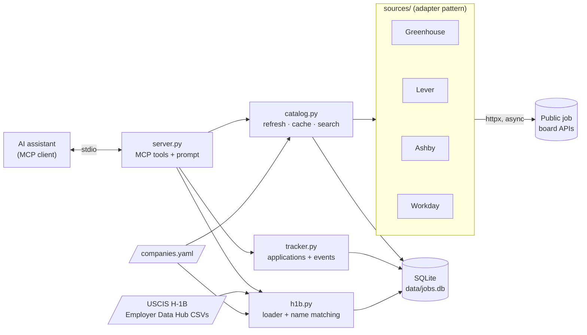

# job-search-mcp

An [MCP](https://modelcontextprotocol.io) server that lets an AI assistant (Claude, or any MCP client) search company job boards, track your applications, and check employers' H-1B sponsorship history.

Ask in plain English:

> *"Find backend or cloud roles in Dallas posted this week at companies that sponsor H-1B."*
> *"Which applications need a follow-up?"*
> *"How many H-1Bs has Capital One sponsored recently?"*
> *"Tailor my resume for that Capital One job."*

The server does the work behind the scenes: it fetches **63 companies across 4 job platforms** (about 14,000 open roles), filters them in SQLite, and joins them against **307,000 USCIS H-1B records** (FY2022–2026).

---

## Tools

| Tool | What it does |
|---|---|
| `search_jobs` | Filter by keywords, locations, remote, posted within N days, company, **H-1B sponsors only** |
| `get_job_details` | Full plain-text description for one job |
| `refresh_jobs` | Re-fetch boards (normally automatic) |
| `save_job` | Add a job to the tracker, from search results or entered by hand |
| `update_application` | Move it through `saved → applied → interviewing → offer / rejected / withdrawn`, and add notes |
| `list_applications` | View the tracker, filtered by status or company |
| `followups_due` | Active applications with no activity in N days |
| `check_sponsorship` | A company's H-1B approvals and denials by fiscal year, plus which USCIS entities matched |

**Prompt:** `tailor_resume(job_id, resume?)` pulls in the job description and your resume (pasted, or from `data/resume.md`) and asks for truthful, targeted bullet rewrites and a gap analysis.

## Architecture



```
server.py              MCP tool + prompt definitions (thin layer)
catalog.py             concurrent fetch, retry, 6h cache, SQL search
tracker.py             application tracker with full event history
h1b.py                 USCIS CSV loader + employer name resolution (CLI too)
db.py                  SQLite schema
sources/
  base.py              Job model + JobSource adapter interface
  greenhouse.py  lever.py  ashby.py  workday.py
companies.yaml         target companies, board ids, optional H-1B name overrides
validate_companies.py  checks every board in companies.yaml against the live API
tests/                 54 tests, all HTTP mocked with respx
```

## Design notes

**Adapter pattern.** Each job board is a `JobSource` subclass that turns its API's payload into a common `Job`. Nothing outside `sources/` knows Greenhouse from Workday, so adding a fifth platform means writing one file. Each adapter also handles that API's quirks:
- **Greenhouse** double-escapes its HTML. The adapter uses `first_published` as the post date, because `updated_at` changes on every edit.
- **Lever** splits descriptions into sections that have to be reassembled.
- **Ashby** sets `isRemote: true` on *hybrid* jobs, so `workplaceType` is treated as the source of truth.
- **Workday** has no public API. The adapter uses the JSON endpoint behind its career pages; see below.

**Workday, the big Dallas employers.** Capital One, Bank of America, Citi, AT&T and similar companies post thousands of jobs on Workday, and the listings say "19 Locations" instead of naming them. The adapter:
1. reads each site's location facets,
2. queries only values that match target cities (Plano, Irving, Dallas…), one city at a time,
3. tags each job with the cities it was found under,
4. fetches descriptions only when you open a job, then caches them.

Adding Workday took the query "backend/cloud roles in DFW this week" from **0 results to 25**.

**Caching (stale-while-revalidate).** All boards are fetched concurrently (semaphore of 10, retries with exponential backoff on connection errors, 429s and 5xx; a 404 fails immediately), and each board's jobs are replaced in one transaction so closed postings disappear. A full refresh takes about 75 seconds, mostly Workday. So only the very first run waits for it: after that, searches are answered from the cache in milliseconds while stale boards refresh in the background. SQLite runs in WAL mode so reads never wait on that writer.

**H-1B entity resolution, the hardest part.** USCIS lists legal entities, while job boards use brand names. `CAPITAL ONE SERVICES LLC` and `CAPITAL ONE NATIONAL ASSOCIATION` are both "Capital One"; Instacart is `MAPLEBEAR INC D/B/A INSTACART`. Matching runs from most to least precise:

1. **Override:** `h1b_names` in `companies.yaml`, for brand ≠ legal name
2. **Exact:** after normalization (case, punctuation, `&`→`and`, D/B/A clauses, trailing `INC`/`LLC`/`N.A.`…), and also ignoring spaces (`DATA BRICKS`)
3. **Prefix:** the company name followed only by corporate qualifiers (`Services`, `Markets`, `Bank`, `Networks`…)
4. **Fuzzy:** rapidfuzz ratio ≥ 94, and only for names of 9+ characters

Rules 3 and 4 come from false positives found in the real data. Plain prefix matching tied Toast to `TOAST WEDDING FILMS` and Intel to `INTEL GRIDS`. Plain fuzzy matching tied Stripe to `STRIPES` and AT&T to `A AND T`. Those cases are now regression tests. Matches are computed once at load time with their method and score, and `check_sponsorship` returns the matched entity names, so a bad match is easy to spot and fix with an override.

**Tracker.** When you save a job, its company, title, location and URL are copied into the tracker. The job cache forgets postings once they close, but your application history shouldn't. Every status change or note is stored as an event, which gives you a full history and makes `followups_due` a single query.

## Setup

Requires Python 3.11+.

```bash
git clone <this repo> && cd job-search-mcp
python -m venv .venv
.venv\Scripts\activate          # Windows
# source .venv/bin/activate     # macOS / Linux
pip install -r requirements.txt
python validate_companies.py    # optional: confirm every board responds
```

### Connect to Claude

**Claude Code:** this repo includes a `.mcp.json`. Update its two paths to your checkout, open the folder, and approve the `job-search` server when asked.

**Claude Desktop:** Settings → Developer → Edit Config, then add:

```json
{
  "mcpServers": {
    "job-search": {
      "command": "C:\\path\\to\\job-search-mcp\\.venv\\Scripts\\python.exe",
      "args": ["C:\\path\\to\\job-search-mcp\\server.py"]
    }
  }
}
```

The first search fetches every board, which takes about 75 seconds. After that, searches are instant.

### Load H-1B data (optional)

USCIS serves the data through an interactive dashboard, so it has to be downloaded by hand:

1. Open the [H-1B Employer Data Hub](https://www.uscis.gov/tools/reports-and-studies/h-1b-employer-data-hub) and click **Crosstab View**.
2. Choose fiscal years (multi-select works), then **Download to Excel → CSV**.
3. Save the files to `data/h1b/` and run:

```bash
python h1b.py load data/h1b/*.csv    # about 6s for 300k rows; prints a match report
python h1b.py report                 # re-check matches after editing companies.yaml
```

The loader handles both the current export (UTF-16, tab-separated, "New Employment / Continuation / Change of Employer" columns) and the archived pre-FY2024 CSVs.

### Add companies

Edit `companies.yaml`. The `board` value comes from the company's careers URL:

| Platform | Careers URL | `board` |
|---|---|---|
| Greenhouse | `boards.greenhouse.io/stripe` | `stripe` |
| Lever | `jobs.lever.co/matchgroup` | `matchgroup` |
| Ashby | `jobs.ashbyhq.com/saronic` | `saronic` |
| Workday | `capitalone.wd12.myworkdayjobs.com/Capital_One` | the whole host/site path |

Workday entries fetch only DFW/Texas/Remote locations by default. Override per company with `locations: [Austin, Houston]`. Then run `python validate_companies.py`.

## Tests

```bash
python -m pytest -q     # 54 tests, ~3s, no network
```

Adapters are tested against mocked payloads that copy each API's real quirks. Catalog tests cover retries, failure isolation, cache TTL and closed postings. Tracker and H-1B tests use a temporary SQLite file and fixed clock times. CI runs on Ubuntu and Windows with Python 3.11 and 3.13.

## Limitations

- **Workday's endpoint is unofficial.** Workday's own career pages use it, but it isn't documented and could change.
- **Workday post dates are approximate.** The listing only says "Posted 3 Days Ago", and anything older shows as "30+ Days Ago".
- **Coverage is only what's in `companies.yaml`.** Companies on other systems (Oracle, iCIMS, Taleo, SuccessFactors) aren't supported yet.
- **H-1B counts aren't a hiring promise.** They count USCIS first decisions per fiscal year for the matched legal entities: whether a company has sponsored, not whether a specific team will.
